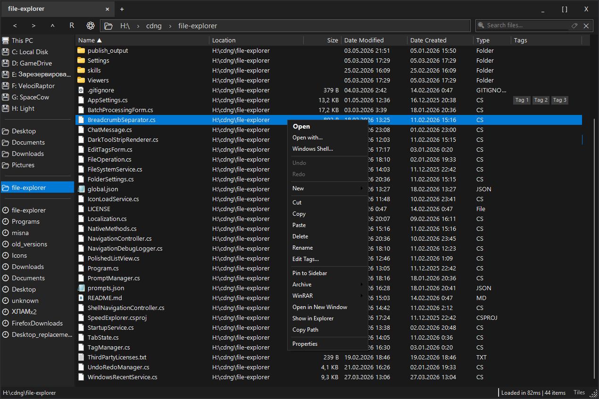

# SpeedExplorer

[](https://github.com/misn-bit/SpeedExplorer/blob/main/Icons/SpeedExplorer_UI_small.jpg)


**SpeedExplorer** is a purely vibe-coded Windows file manager replacement. As in, it’s fully written by AI agents under my guidance.

It's a file manager with a built-in image viewer that has OCR+Translation capabilities using a local AI server. LM Studio and llama.cpp are supported.
The image viewer can show OCR'd text and translation right on top of the image, and it saves the OCR'd text and the translation in a separate text file.

Choose the provider in Settings → AI Assistant (LLM). For llama.cpp, start `llama serve` separately with the GGUF model and optional `--mmproj`, then set the API URL to `http://localhost:8080/v1/chat/completions` (the default when switching from LM Studio). Use **Fetch Models** to select the model alias reported by the running server. SpeedExplorer connects to the server; llama.cpp loads the model files.


For good quality OCR, i recommend using Gemma-4-31B or better. 


It's best to disable the "Enable Thinking" toggle in the server inference tab in LM Studio, unless you prefer the model to potentially think about the OCR for thousands of tokens.

## Development

Build the application with:

```powershell
dotnet build --no-restore
```

Run the automated tests with:

```powershell
dotnet test SpeedExplorer.Tests\SpeedExplorer.Tests.csproj --no-restore
```


## Disclaimer & Safety

**This software is provided "AS IS", without warranty of any kind.**

This project is an experiment in AI-assisted development. The source code was generated by AI models and **has not been manually audited line-by-line** by a human developer.

*   While the application has been tested for stability and safety, unintended behaviors may occur.
*   Always backup critical data before using experimental file management tools.
*   The author is not liable for any data loss or damages arising from the use of this software.
